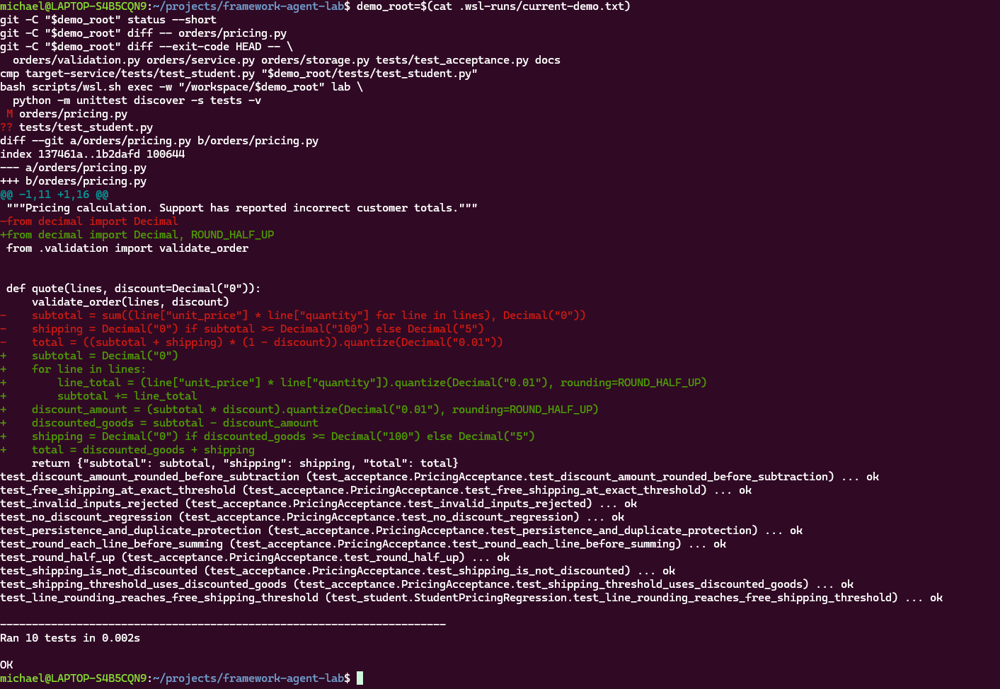

# Week 2 verified agent questionnaire

Name / team: Lena Stadlinger, Michael Reichenberger, Thomas Pleiner.

Repository URL or source ZIP: https://github.com/MichaelReichenberger/framework-agent-lab

Local model tag and preflight result: qwen3:8b; LIVE PROBE PASSED lokal unter
WSL2/Docker mit Python 3.12.15 im bereitgestellten Terminalverlauf.

Answer each in two to five clear sentences and refer to your four-minute video.
Scripted diagnostics support development. Completion requires a live repair.

1. Which part of the Week 1 loop did LangGraph replace? Explain the nodes,
   message updates, routes, and what the 32-step limit guarantees.

   Answer: Im Lab-1-Handout steuerte ein selbst geschriebener Controller bis zu
   15 Modellrunden: JSON-Antwort parsen, Aktion und Berechtigungen prüfen,
   Werkzeug über eine Registry ausführen und Aktion sowie Ergebnis zur Historie
   hinzufügen.
   LangGraph übernimmt diese Ablaufsteuerung mit den Knoten `model`, `tools`
   und `verify` sowie dem gemeinsamen `AgentState`; die Berechtigungsprüfungen
   bleiben in den Python-Tools.
   Der Modellknoten stellt die Systemanweisung vor die Historie und liefert nur
   die neue validierte `AIMessage` mit gegebenenfalls nativen Toolaufrufen zurück,
   die `MessagesState` anhängt; `ToolNode` ergänzt die über `tool_call_id`
   verknüpften Ergebnisse.
   `START` führt zu `model`, Werkzeuganfragen führen zu `tools` und zurück zum
   Modell, während eine finale Antwort über den zusätzlichen Verifikationsknoten
   zu `END` führt.
   Das Limit von 32 Graphschritten beendet eine zu lange Ausführung mit
   `INCOMPLETE`, zählt aber Graphschritte statt der Modellrunden aus Lab 1 und
   garantiert weder eine bestimmte Laufzeit noch eine erfolgreiche Reparatur.

2. Which boundaries do the supplied tools enforce regardless of the model's
   request? Explain both denials and why a fixed test command still needs review.

   Answer: Die Datei-Tools begrenzen Zugriffe auf sichtbare relative Pfade im
   Service-Verzeichnis und lehnen absolute Pfade, `..`, versteckte Komponenten
   und symbolische Links ab.
   Gelesene Dateien und die Pricing-Datei vor und nach einem Edit dürfen maximal
   12.000 Bytes groß sein; das Edit-Werkzeug verändert ausschließlich
   `orders/pricing.py`, und sein nichtleerer Alttext muss genau einmal vorkommen.
   Im geskripteten Verweigerungscheck wurden deshalb der Leseversuch auf
   `../HANDOUT.md` und die mehrdeutige Ersetzung von `Decimal` durch `float`
   abgelehnt, wobei ein Hashvergleich unverändertes Pricing bestätigte.
   `run_tests` verwendet einen festen unittest-Befehl mit 30 Sekunden Timeout
   und verlangt genau `yes`; die vorherige Diff-Prüfung ist Aufgabe des Menschen
   und wird vom Code nicht kontrolliert.
   Die Freigabe ist nötig, weil auch Tests veränderten Python-Code mit den Rechten
   des Prozesses im Container ausführen und die Tool-Grenzen keine
   Betriebssystem-Sandbox bilden.

3. How does your verification node distinguish a final response from verified
   completion? Explain failed/denied tests and an edit after a passing test.
   Identify one incomplete result you demonstrated.

   Answer: `verify` ist ein automatisch nach der finalen Modellantwort
   ausgeführter Graphknoten, der vorhandene Werkzeugergebnisse bewertet und
   selbst weder Tests ausführt noch eine Benutzerfreigabe verlangt.
   Für `verified` muss eine gültige, nichtleere finale `AIMessage` ohne
   Toolaufrufe sowie eine passend zum nativen `run_tests`-Aufruf verknüpfte
   `ToolMessage` ohne Fehlerstatus und mit `exit_code=0` vorliegen.
   Ein späterer erfolgreicher Pricing-Edit entwertet frühere Testerfolge,
   ebenso ein späterer fehlgeschlagener, verweigerter oder fehlerhafter
   Testaufruf; ohne aktuellen Erfolgsbeleg lautet der Abschluss `incomplete`.
   Der im Smoke-Check geprüfte Agentenlauf las nur Dateien und endete daher
   korrekt `incomplete`, weshalb die Diagnose selbst `SMOKE PASSED` meldete;
   der Workflow-Check prüfte zusätzlich verweigerte Tests und veraltete
   Testbelege nach einem weiteren Edit.
   Eine Modellbehauptung allein genügt nicht, allerdings kontrolliert `verify`
   weder den Git-Diff noch ausdrücklich die Anzahl von zehn Tests oder das
   Vorliegen einer tatsächlichen Codeänderung.

4. What evidence shows that the live model read, edited, and tested the service?
   State the model tag, your regression's expected business result and baseline
   failure, the final test result, and protected files you checked. What remains
   unverified?

   Answer: Im gezeigten WSL2/Docker-Lauf auf `.wsl-runs/live-wJ0eaT/service`
   las `qwen3:8b` Regeln, Akzeptanztests und Pricing über native `read_file`-Aufrufe
   und wählte einen tatsächlichen Pricing-Edit mit Call-ID
   `db8f5b49-5ea9-47f0-a52b-9e3ed63a299d`, bestätigt durch die Beobachtung
   `Updated orders/pricing.py once`.
   Nach persönlicher Freigabe lieferte `run_tests` mit Call-ID
   `6afc067e-7cc8-412e-994a-bf2f17bf8d08` die Beobachtung `exit_code=0` mit
   neun bestandenen Akzeptanztests und dem bestandenen Regressionstest,
   anschließend meldete der Graph `VERIFIED`.
   Vor der Reparatur scheiterten fünf Akzeptanztests und der mit
   Codex-Unterstützung erstellte Regressionstest: Für eine Position von
   99,995 EUR erwartet er nach HALF_UP-Rundung Subtotal und Gesamtpreis von
   100,00 EUR sowie kostenlosen Versand, während die Baseline 99,995 EUR
   Subtotal, 5 EUR Versand und 105,00 EUR Gesamtpreis lieferte.
   Die im ergänzenden Screenshot dokumentierte unabhängige Prüfung bestand
   ebenfalls alle zehn Tests und zeigte den Pricing-Diff sowie nur Pricing als
   geändert und den Studententest als neu; die Diff-Prüfung von
   `orders/validation.py`, `orders/service.py`, `orders/storage.py`,
   `tests/test_acceptance.py` und `docs` sowie der Vergleich des Regressionstests
   mit `cmp` blieben ohne Ausgabe.
   Endliche Tests beweisen außerdem keine Korrektheit für alle Eingaben,
   die Tool-Grenzen bieten keine Betriebssystem-Sandbox und die Systemanweisung
   gibt dem Modell bereits die fachliche Berechnungsreihenfolge vor.

## Ergänzender Nachweis zu Antwort 4

Die unabhängige Prüfung wurde durchgeführt, konnte aber aus Zeitgründen im
Vier-Minuten-Video nicht mehr gezeigt werden. Dieser Screenshot ergänzt den
Videonachweis um den Diff und den unabhängigen Zehn-Test-Lauf; die Exitcodes
des geschützten Diffs und von `cmp` sind nicht separat eingeblendet.

